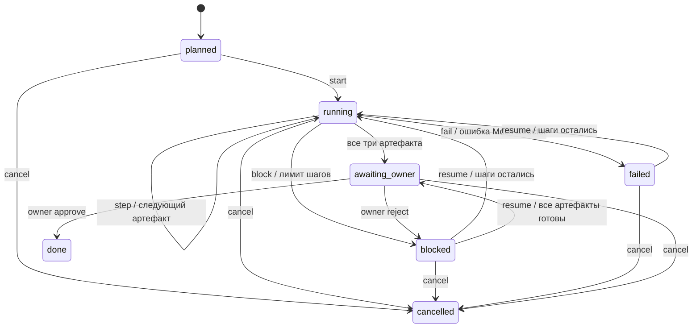

# Офлайн-процесс задач: контракт v1

[English](TASKFLOW.en.md) · [Issue #27](https://github.com/KalyuzhniyKO/AICommander-v3/issues/27) · родительский этап [#14](https://github.com/KalyuzhniyKO/AICommander-v3/issues/14)

Компонент работает только с **Mock Director**: детерминированно создаёт требования, проект и план, сохраняет их и передаёт содержимое следующей роли. Он не подключает Hermes/OmniRouter/Codex, не вызывает модели, не исполняет shell, не изменяет файлы проекта и не выполняет QA. Родительская задача #14 этим компонентом не завершена.

`done` означает исключительно **согласованные владельцем mock-артефакты**. В каждом ответе есть `director: "mock"`, `simulated: true`, `completion_scope: "mock_artifacts_only"`; в плане — `execution: "not_executed"`. Эти поля запрещено трактовать как выполненный код, успешные тесты или deploy.

## Состояния и передача результатов

Новый процесс создаётся для существующей legacy-задачи `/tasks`. У одной задачи может быть несколько независимых процессов. Статус и раунды старого API не перезаписываются.



`done` и `cancelled` — конечные состояния. Другие переходы отклоняются с HTTP 409 и без изменений в БД. Ни Mock Director, ни `step` не принимают решение владельца.

Роли и артефакты фиксированы в v1:

| Роль | Тип | Содержимое и входы |
|---|---|---|
| `analyst` | `requirements` | Обезличенная исходная цель и критерии приёмки; входных артефактов нет. |
| `architect` | `design` | **Содержимое требований аналитика** и список компонентов; ссылка на requirements artifact. |
| `developer` | `plan` | **Содержимое проекта архитектора**, шаги плана, `execution: not_executed`; ссылки на requirements/design. |

Артефакт содержит `artifact_id`, `task_id`, `run_id`, `role`, `type`, `status`, `content`, `input_artifact_ids`, `created_at`, `redacted`, `simulated`. Сохраняется один неизменяемый артефакт каждой роли в пределах процесса. Последующая роль получает артефакты только своего процесса. Требования и проект передаются как типизированные объекты, а не как повтор исходного prompt.

Этапы имеют статусы `pending`, `ready`, `completed`, `failed`, `blocked`, `cancelled`. Здесь нет фоновых работников: один `step` атомарно рассчитывает mock-результат. Поэтому `running` относится к процессу, а не служит заявлением о выполняющейся внешней роли. Готовый к шагу этап обозначается `ready`.

## API

Namespace `/taskflow` независим от существующих endpoints. Панель PR #30 использует этот namespace; legacy-раунды отображаются отдельно. JSON-тела обязательны у POST; неизвестные поля и команды отклоняются HTTP 422.

| Метод и путь | Тело / ответ |
|---|---|
| `POST /taskflow/tasks/{task_id}/runs` | `CreateRun` → `RunSnapshot` в `planned`. |
| `GET /taskflow/tasks/{task_id}/runs` | До 100 последних процессов задачи, от нового к старому; `RunSnapshot[]`. |
| `GET /taskflow/runs/{run_id}` | Согласованный снимок процесса, этапов, артефактов и timeline. |
| `POST /taskflow/runs/{run_id}/commands` | `Command` → `RunSnapshot`. |
| `POST /taskflow/runs/{run_id}/owner-decision` | `OwnerDecision` → `RunSnapshot`. |

Минимальный пример:

```json
{"idempotency_key":"demo-create","max_steps":3}
```

После создания версия равна 1. Запуск:

```json
{"idempotency_key":"demo-start","expected_version":1,"action":"start"}
```

После `start` версия 2. Три отдельных запроса `step` с разными ключами и актуальными `expected_version` 2, 3, 4 создадут три артефакта и версию 5 в `awaiting_owner`:

```json
{"idempotency_key":"demo-analyst","expected_version":2,"action":"step"}
```

Явное согласование только через `owner-decision`:

```json
{"idempotency_key":"demo-approve","expected_version":5,"decision":"approve","reason":"План проверен"}
```

Разрешены команды `start`, `step`, `block`, `resume`, `fail`, `cancel`. Решения владельца — `approve` и `reject`. Поле `reason` необязательно, до 2000 символов. `idempotency_key` — 1–64 символа из латинских букв, цифр, `._:-`, первый символ — буква или цифра. Не передавайте в ключе credentials.

`block_code` различает `manual`, `step_limit`, `role_failure`, `owner_rejected`. `owner_decision` хранит последнее явное решение: после reject/resume оно остаётся `rejected` до нового решения владельца. `resume` после отказа возвращает готовые артефакты в `awaiting_owner`, не создаёт их заново.

### Ошибки, повторы и лимит

HTTP 404: `task_not_found` / `run_not_found`. HTTP 409: `invalid_transition`, `stale_version`, `idempotency_conflict`, `step_limit`. Формат доменной ошибки:

```json
{"detail":{"code":"stale_version","message":"Версия изменилась; перечитайте состояние процесса"}}
```

Каждая принятая команда увеличивает `version` ровно один раз, включая явное согласование и ошибку mock-расчёта. GET не меняет версию. Команда с неактуальной версией отвергается; после HTTP 409 UI должен перечитать состояние и принять решение, не повторять шаг вслепую.

Одинаковый ключ и идентичное тело команды возвращают **сохранённый первоначальный ответ**, даже после дальнейших изменений процесса. Повтор не вызывает Director и не расходует шаг. UI не должен заменять более новый снимок старым replay-ответом. Другие тело, версия или endpoint с тем же ключом дают `idempotency_conflict`. Ошибочные/отклонённые запросы ключ не резервируют.

Повтор создания с теми же ключом, задачей и лимитом возвращает тот же `run_id` и **текущий** снимок. Другой лимит с тем же ключом — конфликт. Для другого процесса нужен другой ключ. Ключи хранятся как SHA-256; исходные тела команд не сохраняются, только hash и обезличенный ответ.

`max_steps` — целое число 1–100, по умолчанию 3. Считаются попытки mock-расчёта роли, включая ошибку Director, а не GET/управляющие команды. Когда попытки исчерпаны до готовности всех ролей, процесс блокируется; `resume` не обходит лимит. Лимит процесса неизменяем. Для завершения после неудачной попытки нужен заранее достаточный бюджет. Отмена остаётся доступной после исчерпания лимита.

Исключение Mock Director или некорректный результат переводят процесс и этап в `failed` с общей безопасной причиной; произвольный текст исключения не сохраняется. Это HTTP 200 с явным failed-состоянием, **не успешный артефакт**. Ошибка записи SQLite откатывает весь шаг, не оставляя артефакта, нового состояния, события или idempotency-записи.

## Хранение и перезапуск

Миграция 1 в `backend/app/storage/migrations.py` добавляет `taskflow_migrations`, `taskflow_runs`, `taskflow_stages`, `taskflow_artifacts`, `taskflow_events`, `taskflow_commands`. Она вызывается через `init_db`, выполняется транзакционно и повторно безопасна. Старые tasks/rounds/outputs не преобразуются и не удаляются. Это не миграция production-склада.

Запись использует `BEGIN IMMEDIATE`: проверка версии, чистый mock-расчёт, состояние, артефакт, событие и сохранённый ответ фиксируются одним commit. Конкурентный повтор с тем же ключом воспроизводит ответ; с другим ключом и старой версией получает конфликт. Чтение snapshot выполняется в согласованной read-транзакции.

После перезапуска приложения/нового Python-процесса продолжение начинается с GET и актуальной версии. Нет фонового автоматического возобновления. Следующий `step` использует сохранённые артефакты, а повтор старого ключа — сохранённый ответ. Если процесс завершается до commit, SQLite откатывает незавершённую транзакцию; внешний побочный эффект отсутствует, поскольку Mock Director чистый. Для будущего реального executor потребуется отдельный протокол внешних эффектов; гарантия этого компонента на него не переносится.

Откат к предыдущему коду оставляет дополнительные таблицы неиспользуемыми; автоматического DROP или удаления данных нет.

## Контракт для UI и ограничения

- [JSON Schema ответа v1](contracts/taskflow-v1.schema.json).
- [Схемы CreateRun/Command/OwnerDecision](contracts/taskflow-v1.requests.json) — объект трёх самостоятельных JSON Schema.
- [Пример awaiting_owner](contracts/taskflow-v1.example.json) — fixture с фиксированными примерными timestamps, не журнал реального исполнения.

Воспроизводимое обновление: `python -m backend.app.taskflow.export_contract`. Экспорт использует только in-memory SQLite, не конфигурацию/БД приложения. Тест сравнивает сохранённые схемы с моделями и валидирует fixture; изменения контракта требуют явного обновления файлов. Схемы маршрутов доступны после авторизации через `/openapi.json`. Встроенный Swagger UI `/docs` требует внешних assets, заблокированных строгим CSP панели.

В основном приложении все `/taskflow/*` защищены middleware панели: HTTP Basic, серверный пароль минимум 32 символа, обязательный CSRF заголовок и проверка Origin/Host. Сам `create_router` не является независимым сервером авторизации: при подключении к другому FastAPI app требуется аналогичная защита. Поддерживаемый доступ с MacBook — localhost через SSH tunnel; см. [MACBOOK_PANEL](MACBOOK_PANEL.md). Старые API раундов по-прежнему отдельны и могут вызывать модели при наличии ключа; новые `/taskflow/*` этого не делают.

Для текста новых артефактов и причин применяется best-effort маскировка `Bearer`, `sk-*`, присваиваний/JSON-полей `api_key`, `*token`, `password`, `secret`, `client_secret`, `authorization`. Это не распознавание произвольных секретов и не разрешение их вводить. Существующая legacy-задача хранится старым API без изменения; taskflow не переписывает её описание. Не отправляйте секреты ни в тексты, ни в idempotency keys.

Проверки: `python -m compileall backend`, `python -m pytest -q`, `python -m pip check`. Новые тесты — `tests/test_taskflow.py`: handoff, недопустимые переходы, согласование/отказ, отмена, лимит, restart нового app и отдельного процесса Python, конкурентные запросы, rollback шага, миграция старой БД и rollback миграции, маскировка и frozen contract. Результаты фактических команд — в [qa-issue-27.json](qa-issue-27.json).
